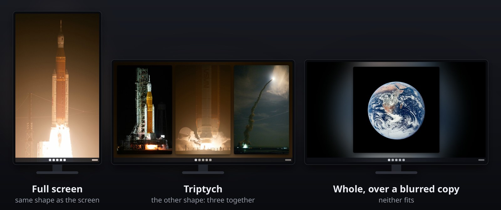
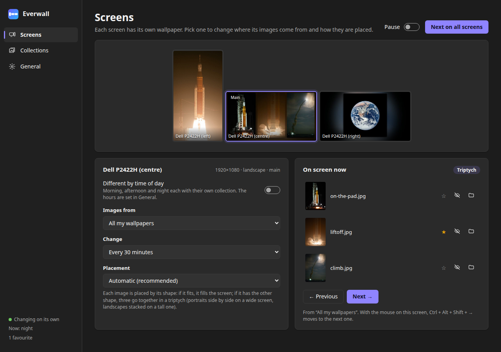

<p align="center">
  
</p>

<h1 align="center">Everwall</h1>

<p align="center">
  A different wallpaper on each screen, laid out to suit its shape.<br>
  A tray app for Windows 11 and Ubuntu (GNOME), built with Rust and Tauri.
</p>

<p align="center">
  <a href="https://github.com/johan-socarras/Everwall/releases/latest"></a>
  <a href="LICENSE"></a>
  
</p>



<p align="center"><sub>Photos: NASA, public domain (the Artemis I launch by Joel Kowsky, the Earth by the Apollo 17 crew).</sub></p>

Windows can show a slideshow, but it picks images blindly: a portrait photo on
a landscape monitor ends up cropped or letterboxed, and a rotated monitor gets
images that were never meant for it. GNOME cannot even give each screen its
own wallpaper. Everwall takes its wallpapers from collections of folders and
looks at each image and each screen before it decides how to place it.

## Download

Both packages are in the
[latest release](https://github.com/johan-socarras/Everwall/releases/latest).

### Windows 11

1. Download `Everwall-<version>-windows-x64.zip`.
2. Unzip it into a folder of your own, for example
   `%LOCALAPPDATA%\Programs\Everwall`, and keep `Everwall.exe` and
   `WebView2Loader.dll` together.
3. Run `Everwall.exe`. The executable is not code-signed, so the first time
   Windows may show "Windows protected your PC": choose **More info → Run
   anyway**.

On first run Everwall makes one collection with everything under
`Pictures\Wallpapers` (or `Pictures` if that folder does not exist) and one
per subfolder, and starts in Spanish or English following the Windows
language. Both can be changed in the settings window.

It starts with Windows from wherever it is. If you move the folder, run it once
from the new place.

**To uninstall:** in General, use "Restore my previous wallpapers" to get your
old wallpapers and accent colour back, turn off "Start with Windows", quit from
the tray menu, and delete the app folder and `%LOCALAPPDATA%\Everwall`.

### Ubuntu (GNOME)

Made for GNOME on Wayland or X11. The release package is built and tested on
Ubuntu 26.04 (GNOME 50); on an older Ubuntu, build it from source. The accent
colour needs GNOME 47 or later. It needs WebKitGTK 4.1, the AppIndicator
support Ubuntu ships for tray icons, and `zenity` for the folder picker:

```sh
sudo apt install libwebkit2gtk-4.1-0 libayatana-appindicator3-1 zenity
```

1. Download `Everwall-<version>-linux-x64.tar.gz` and unpack it.
2. In the unpacked folder, run `./install.sh`. It copies `everwall` to
   `~/.local/bin`, adds it to the app grid and starts it.

On first run Everwall makes one collection with everything under
`~/Pictures/Wallpapers` (or `~/Pictures`) and one per subfolder, and starts in
Spanish or English following the session language. It starts when you log in
(an entry in `~/.config/autostart`) and adds its keyboard shortcuts to
Settings › Keyboard › Custom Shortcuts.

**To uninstall:** run `./install.sh --uninstall`. It puts back the wallpaper
and accent colour you had before Everwall, removes its shortcuts, the autostart
entry and the program, and leaves your settings in `~/.local/share/Everwall`.

## How it places an image

- **Full screen** when the image already has the screen's shape and cropping
  it loses less than 30 %.
- **Triptych** when it has the other shape: three images from the same folder
  side by side (portraits on a landscape screen) or stacked (landscapes on a
  portrait screen).
- **Whole, over a blurred copy** of itself, when neither fits.

Every wallpaper is rendered at the exact resolution of its screen, keeping the
panels inside the work area so the taskbar never covers them. Windows receives
it with "Fill", so it is never stretched or cropped again. GNOME takes a single
picture for all the screens, so on Ubuntu Everwall joins them into one picture
the size of the whole desktop and sets it as "spanned": each screen shows its
own part.

## Features

- A collection (a group of folders) per screen, or a different one for
  morning, afternoon and night.
- Weighted random picks: favourites come up three times as often, and recent
  images or images already on another screen are skipped.
- Accent colour taken from the wallpaper, changed at most every few hours
  (each change makes Windows repaint every window). GNOME has nine accent
  colours, so there it picks the closest one.
- Pauses while a game or video is full screen. GNOME does not tell apps about
  full screen, so on Ubuntu this option waits while something asks to keep the
  screen on instead. Some apps ask all the time, so there it starts off.
- Starts with the system and lives in the tray; the settings window only exists
  while it is open.
- Favourites, hidden images and a "restore my previous wallpapers" button that
  also gives back the original accent colour.
- Keyboard shortcuts: → next, ← previous, ↑ favourite, ↓ hide. On Windows they
  are Ctrl + Alt + Shift + arrow, on the screen under the mouse. On Ubuntu they
  are Super + Ctrl + Alt + arrow (GNOME already uses the other ones), on the
  main screen: Wayland does not tell apps where the mouse is.
- Interface in English or Spanish.



## How it is built

- `src-tauri/`: Rust with Tauri 2. One code base: what each system does
  differently lives in a `win.rs` and a `linux.rs` under `screens/`,
  `system/` and `accent/`, with the same functions.
  - `engine.rs`: a single thread makes every change.
  - `render.rs`: composes each wallpaper at its screen's size.
  - `screens.rs`: monitors, their work areas and their orientation, and
    setting the wallpaper: the Windows per-monitor wallpaper API
    (`IDesktopWallpaper`), or Mutter's display configuration over D-Bus and
    GNOME's background settings.
  - `library.rs`: scans the folders and caches image sizes.
  - `accent.rs`: picks the dominant colour and writes the accent colour.
  - `system.rs`: local time, language, starting with the system, one instance
    only, the shortcuts, the folder picker.
- `ui/`: the settings window, in plain HTML, CSS and JavaScript with no
  libraries. Opened in an ordinary browser it shows sample data.
- `install.ps1` and `package.ps1`: install from source on Windows, or build
  the release zip. `install.sh` and `package.sh` do the same on Linux.
- `tools/make-icon.ps1`: draws the icon.

A second launch does not start another copy: it hands its order to the one
already running.

## Build from source

### Windows

Requires:

- Rust with the GNU toolchain as the default:
  `rustup default stable-x86_64-pc-windows-gnu`.
- MinGW-w64 with its `bin` folder on the `PATH`, because Rust's GNU toolchain
  does not include `windres`, which builds the icon and the manifest into the
  executable. [WinLibs](https://winlibs.com) works:
  `winget install BrechtSanders.WinLibs.POSIX.MSVCRT`.
- PowerShell 7 (`winget install Microsoft.PowerShell`): the scripts use it,
  and Windows 11 only includes Windows PowerShell 5.1.
- WebView2, which ships with Windows 11.

```powershell
pwsh -File install.ps1
```

It builds with `cargo build --release`, copies `Everwall.exe` and
`WebView2Loader.dll` to `%LOCALAPPDATA%\Programs\Everwall`, adds a Start menu
shortcut and starts it. `pwsh -File package.ps1` builds the release zip
instead.

### Ubuntu

Requires Rust and the libraries Tauri builds against:

```sh
sudo apt install build-essential libwebkit2gtk-4.1-dev libgtk-3-dev \
  libayatana-appindicator3-dev librsvg2-dev libssl-dev zenity
./install.sh
```

It builds with `cargo build --release`, installs and starts it as above.
`./package.sh` builds the release tar.gz instead.

## Privacy

Everwall's code makes no network connections and sends nothing anywhere (the
settings window runs in Microsoft's WebView2 on Windows and in WebKitGTK on
Ubuntu, both kept updated by the system). Settings, state, the image index, a
log and the rendered wallpapers stay on your PC, in `%LOCALAPPDATA%\Everwall`
or `~/.local/share/Everwall`. On Ubuntu it only talks to your own session over
D-Bus: GNOME's display configuration, its "keep the screen on" requests and
the file manager.

## Checking it without changing the wallpaper

```powershell
.\Everwall.exe --diagnostics out.txt   # screens, collections, time of day
.\Everwall.exe --samples folder        # every layout rendered for every screen
```

Run them in the app's folder. On Ubuntu the same options go to `everwall`.

## License

Copyright (C) 2026 Johan Socarras.

Everwall is free software under the [GNU General Public License v3.0](LICENSE):
you may use, study, share and modify it, and any version you distribute must
keep this license and come with its source code.
